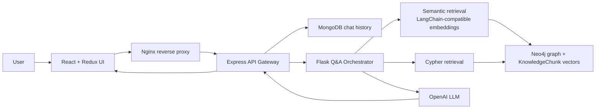

# SesameKiller-Compass

SesameKiller-Compass is an airport-benefit GraphRAG platform demo: a travel-domain Q&A app with React, Express.js, Flask, MongoDB, Neo4j, LangChain-style semantic retrieval, Cypher graph retrieval, Docker, Nginx, tests, and CI.

The app answers questions about 10 sample airports, their terminals, restaurants, and credit-card benefits. It is the initial demo slice of a larger airport-benefit GraphRAG platform: the next planned layer is a legal public API / crawler pipeline that exports normalized airport and benefit data for Neo4j/MongoDB import.

## Architecture



## Quick Start

1. Copy environment defaults if you want to customize them:

```bash
cp .env.example .env
```

2. Start the full local stack with Docker-managed MongoDB and Neo4j:

```bash
docker compose up --build
```

3. Open the demo:

```text
http://localhost:8080
```

Useful service URLs:

```text
Frontend via Nginx: http://localhost:8080
Frontend direct:    http://localhost:5173
Express API:        http://localhost:3001/api/health
GraphQL:            http://localhost:3001/graphql
Flask RAG service:  http://localhost:5001/health
Neo4j Browser:      http://localhost:7474
Neo4j login:        neo4j / local-password
MongoDB:            mongodb://localhost:27017/sesamekiller_compass
```

The Flask service auto-seeds Neo4j on first startup. To reset the graph data:

```bash
docker compose exec rag-service python -m app.seed
```

## Cloud Database Demo

For the future product direction, use managed free database services instead of the local database containers:

```text
MongoDB Atlas Free -> chat/session data
Neo4j AuraDB Free  -> airport-benefit graph and vector chunks
```

After you create those cloud instances and put their connection strings in `.env`, run the app without local database containers:

```bash
docker compose -f docker-compose.cloud.yml up --build
```

Cloud database setup instructions are in [docs/cloud-databases.md](docs/cloud-databases.md).

## Try These Questions

```text
What restaurants and Atlas Platinum benefits are available at RWI?
Does Blue Harbor International have lounge access?
Find dining credits at Desert Bloom Airport.
Which restaurants are in the Fern Terminal?
What benefits does Meridian Miles Reserve have at HVA?
```

## Implemented

- React + TypeScript frontend with Redux Toolkit state, React Router views, Material UI controls, Ant Design segmented trace tabs, styled-components shell styling, Tailwind pipeline, lucide icons, and Chart.js latency chart.
- Express.js API gateway with REST endpoints, Apollo GraphQL read endpoints, optional JWT parsing, and MongoDB chat persistence.
- Flask RAG service with a Q&A orchestrator that follows the workflow discussed in chat.
- Semantic retrieval through a LangChain-compatible embedding adapter. It uses a deterministic local hash embedding by default, but answer generation still requires an OpenAI API key.
- Cypher retrieval against local Neo4j using safe read-only query templates.
- Answer generation using OpenAI through LangChain. If `OPENAI_API_KEY` is missing, the app returns an error after retrieval instead of generating any local answer.
- Local Neo4j seed graph with 10 sample airports, terminals, restaurants, credit cards, benefits, and `KnowledgeChunk` vector records.
- Docker Compose stack for Neo4j, MongoDB, Flask, Express, React, and Nginx.
- Cloud Compose stack for running the same app against MongoDB Atlas and Neo4j AuraDB.
- GitHub Actions CI for API tests/build, frontend tests/build, and Python RAG tests.

## Not Implemented Yet

- Real production data ingestion. The current data is generated sample demo data in `database/seed/airports.json`.
- LLM-generated Cypher. The current implementation uses safer template-based Cypher retrieval. Adding LLM-generated Cypher would require schema prompting, validation, allowlisted clauses, query timeouts, and read-only permissions.
- True streaming responses. The UI shows loading state, but the backend returns the answer after retrieval/generation completes.
- Production authentication and user accounts. JWT is included only as a demo mechanism.
- AWS deployment and Cloudflare CDN. The local version uses Docker Compose and Nginx. Production deploy can be added with ECS/EC2, managed MongoDB, managed Neo4j, and Cloudflare in front of static assets.
- Full evaluation harness for the 92% structured-answer accuracy metric. This repo has unit tests, but not a back-test dataset or scoring script yet.
- Redis/PostgreSQL/Spring Boot/Vue. These are listed in the broader skill set, but they were not necessary for this initial Compass demo.
- Production dependency hardening. The demo uses Apollo Server v4 for a simple GraphQL endpoint, and `npm install` currently prints deprecation/audit warnings. For production, upgrade that layer to Apollo Server v5 or another maintained GraphQL server.
- LLM-free answer mode. This was intentionally removed, so missing or failing LLM generation returns an error.

## Code Map

```text
apps/frontend        React demo UI
apps/api             Express API gateway, REST, GraphQL, MongoDB persistence
services/rag-service Flask Q&A orchestration, semantic retrieval, Cypher retrieval, answer generation
database/seed        Sample airport graph data
database/neo4j       Neo4j schema reference
database/mongo-init  MongoDB collection/index initialization
nginx                Local reverse proxy
docs                 Diagrams and system-design notes
```

## Where Each CV Technology Appears

```text
React / TypeScript: apps/frontend
Redux Toolkit:      apps/frontend/src/store
React Router:       apps/frontend/src/App.tsx
Material UI:        apps/frontend/src/components/ChatPanel.tsx
Ant Design:         apps/frontend/src/components/RetrievalTrace.tsx
Tailwind CSS:       apps/frontend Tailwind pipeline
styled-components:  apps/frontend/src/App.tsx
Chart.js:           apps/frontend/src/components/LatencyChart.tsx
Node.js / Express:  apps/api
Flask / Python:     services/rag-service
REST APIs:          apps/api/src/routes/chat.ts
GraphQL / Apollo:   apps/api/src/graphql.ts
JWT:                apps/api/src/middleware/auth.ts
MongoDB:            apps/api/src/db/mongo.ts
Neo4j / Cypher:     services/rag-service/app/neo4j_client.py
Docker / Nginx:     docker-compose.yml and nginx/default.conf
CI/CD:              .github/workflows/ci.yml
```

## Adding Your OpenAI API Key

Create `.env` from `.env.example` and set:

```bash
OPENAI_API_KEY=your_key_here
OPENAI_MODEL=gpt-4o-mini
```

Then restart:

```bash
docker compose up --build
```

By default, embeddings still use the local 64-dimensional demo model. If you want OpenAI embeddings too, set `EMBEDDING_PROVIDER=openai`, reset the Neo4j volume, and reseed the graph so the vector index dimensions match the OpenAI embedding model.

## Local Development Without Docker

Run databases yourself first:

```bash
docker compose up mongo neo4j
```

Then run each app:

```bash
cd services/rag-service
pip install -r requirements.txt
PYTHONPATH=. AUTO_SEED=true python -m app.main
```

```bash
cd apps/api
npm install
npm run dev
```

```bash
cd apps/frontend
npm install
npm run dev
```

## Tests

```bash
cd apps/api
npm test
```

```bash
cd apps/frontend
npm test
```

```bash
PYTHONPATH=services/rag-service pytest services/rag-service/tests
```
