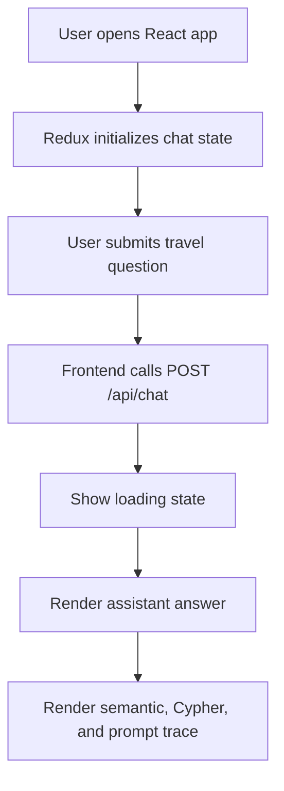
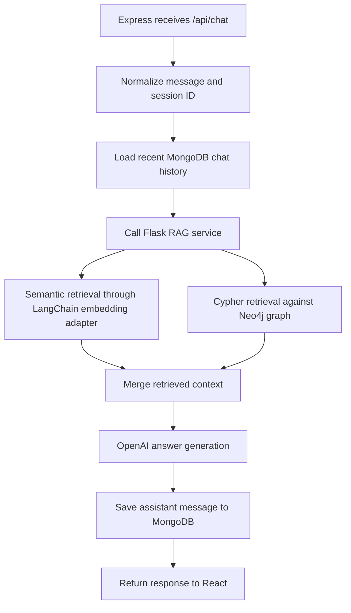
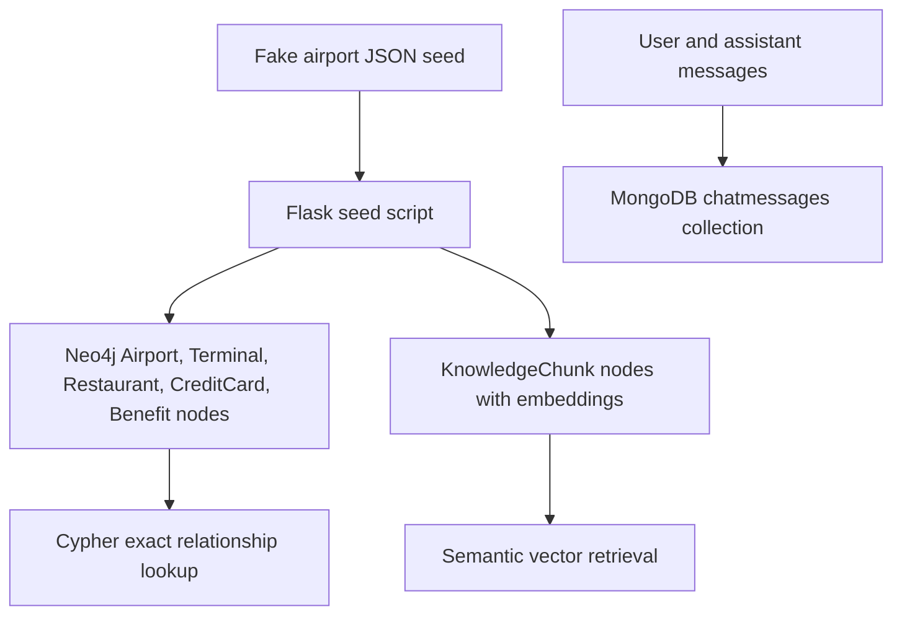

# SesameKiller-Compass System Design

## Frontend Workflow

## Backend Q&A Orchestration

## Database Workflow

## Retrieval Strategy

The service uses two retrieval paths:

- Semantic retrieval: the user question is embedded by a LangChain-compatible embedding model. The vector is queried against `KnowledgeChunk` nodes in Neo4j.
- Structured retrieval: the service resolves airport codes or names from the question and runs a safe read-only Cypher template to fetch exact terminals, restaurants, and card benefits.

The two outputs are sent into the answer generator. `OPENAI_API_KEY` is required for final answer generation. Without a key, retrieval still runs, but the service returns an explicit error instead of generating any local answer.
